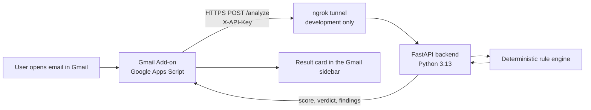

# MailGuard

**A deterministic, explainable email security scoring engine for Gmail.**

MailGuard is a Gmail Add-on backed by a Python FastAPI service. When a user opens an email, the add-on sends the message's metadata and content to the backend. The backend scores the email from 0 to 100, classifies the likely attack type, and explains its verdict in plain language, with specific findings and recommended actions.

Every verdict is produced by a deterministic rule engine. This design prioritizes speed and data privacy by eliminating external LLM calls in the critical path, keeping detection deterministic. This ensures the same email always gets the same score, and every point can be traced to a named rule.

---

## Table of contents

- [Core philosophy](#core-philosophy)
- [Architecture](#architecture)
- [How scoring works](#how-scoring-works)
- [Security by design](#security-by-design)
- [Local setup and deployment](#local-setup-and-deployment)
- [API reference](#api-reference)
- [Project structure](#project-structure)
- [Known limitations](#known-limitations)
- [Roadmap](#roadmap)

---

## Core philosophy

- **Privacy first.** No external LLM or third-party analysis service sits in the critical path. Email content is analyzed in memory and is never stored or logged.
- **Deterministic and explainable.** Every finding comes from a named rule with a fixed weight. Analysts can see exactly why an email scored the way it did, and results are reproducible.
- **Additive scoring.** Signals only ever add risk. An attacker cannot lower an email's score by padding it with benign text, a technique that defeats many statistical spam filters.
- **Thin client, fat server.** The add-on only extracts data and renders the result. All detection logic lives in the backend, so the add-on can never disagree with it.
- **Treat every email field as hostile.** Sender names, subjects, bodies, URLs and attachment names are all attacker-controlled input.
- **Never touch attacker infrastructure.** URLs are parsed statically. MailGuard never fetches, resolves or follows them, so analysis never alerts the attacker or triggers one-click actions.

---

## Architecture



1. **Gmail Add-on (`addon/`).** A contextual trigger fires when the user opens an email. Using the per-message access token Gmail provides, the add-on reads:
    - sender name and address, Reply-To and subject
    - plain-text and HTML bodies
    - attachment names

   It caps each field to the backend's limits and posts the result as JSON.
2. **Transport.** For local development, an [ngrok](https://ngrok.com/) tunnel exposes the local backend over HTTPS so Apps Script can reach it. See [Known limitations](#known-limitations) for why this is development-only.
3. **FastAPI backend (`backend/`).** Validates the request against a strict schema and runs the rule engine. It returns a structured, explainable verdict and stores nothing.
4. **Result card.** The add-on renders the verdict with CardService: a color-coded banner, the attack type, a "why" explanation, findings and recommendations. Every failure path (network error, timeout, 4xx/5xx) renders a clear error card instead of crashing.

---

## How scoring works

The engine evaluates four rule categories. Each category is capped, so a single noisy category cannot dominate the verdict. The total score is the sum of the categories, capped at 100.

| Category | Max | Examples of rules |
| --- | --- | --- |
| Sender | 35 | Reply-To on a different domain; malformed or IP-literal sender; brand names in non-brand domains (`paypa1-security.xyz`); display-name brand spoofing |
| Links | 40 | Link text shows one domain but points to another; `user@host` URL tricks; raw-IP links; brand names in link hosts; punycode domains; URL shorteners; direct links to executables |
| Content | 25 | Dangerous, macro-enabled or archive attachments; double extensions (`invoice.pdf.exe`); hidden text-direction characters in file names; urgency, credential and payment language |
| Evasion | 40 | Techniques aimed at scanners themselves: multiple Reply-To addresses, backslash URL tricks, body padding, encrypted archives with the password in the message |

| Score | Verdict |
| --- | --- |
| 0–19 | Low |
| 20–44 | Medium |
| 45–69 | High |
| 70–100 | Critical |

**Critical override.** Some signals are definitive indicators of compromise rather than probabilities: an executable attachment, a double extension, or a disguised file name. Any of these forces the score to at least 75, the verdict to Critical and the attack type to Malware Delivery, regardless of the other categories.

**Attack types** are assigned in priority order: Malware Delivery, Credential Phishing, Business Email Compromise (BEC), Sender Spoofing / Impersonation, Detection Evasion, Social Engineering.

---

## Security by design

### Untrusted input handling

- **Strict schema validation.** Requests are validated by Pydantic v2 models in strict mode:
    - Unknown fields are rejected and there is no type coercion.
    - Every field has a maximum length, for example 998 characters for the subject and 500,000 for the HTML body.
    - At most 50 attachment names are accepted.
- **Malformed is a signal, not an error.** Sender addresses are deliberately not validated as email addresses at the schema level. A malformed sender is scored as suspicious instead of being rejected, so attackers cannot bypass analysis by sending a malformed header.
- **Bounded processing.**
    - At most 500 links are analyzed per email, and text scanning stops at 200,000 characters.
    - Text is normalized before scanning: zero-width and invisible characters are stripped so they can't split keywords.
- **Safe HTML parsing.** HTML is parsed with BeautifulSoup. `<script>`, `<style>`, `<noscript>` and `<template>` content is excluded from visible-text analysis.

### Output safety in the UI

- **HTML escaping.** CardService text widgets render a subset of HTML. Every string from the backend is HTML-escaped before rendering, so text from an email can never inject markup or a clickable link into the sidebar.
- **Minimal reflection.** Findings never echo body text or attachment names. The only email-derived values shown are hostnames, filtered to a strict ASCII character set, so bidi-override and homoglyph characters never reach the UI.
- **Response validation in the add-on.** The add-on checks the backend's response shape, verdict and score range, and caps every string and list before rendering anything.

### Transport and API hardening

- **1 MB request limit.** A pure-ASGI middleware enforces the limit on both the declared `Content-Length` and the bytes actually received, so chunked requests and false headers can't get past it. At most 1 MB is ever buffered.
- **API key authentication.** `POST /analyze` requires an `X-API-Key` header, compared in constant time.
- **Fail-closed configuration.** The server refuses to start unless `MAILGUARD_API_KEY` is explicitly set. There is no built-in fallback key.
- **No schema exposure.** The interactive docs (`/docs`, `/redoc`) and `/openapi.json` are disabled.
- **No content echo in errors.** A custom validation-error handler returns only each error's location and type. FastAPI's default 422 response would echo the offending input back to the caller.
- **Add-on hardening:**
    - The manifest requests only three permissions: run as a Gmail add-on, read the currently open message, and make outbound requests.
    - Outbound requests are allow-listed to the backend URL only.
    - Redirects are never followed, so the API key can't be forwarded to another host.
    - The request is size-budgeted to 900 KB before sending.
    - Logs record only the failure stage and error type, never email content.

### Evasion protections

MailGuard specifically defends against techniques that target the scanner rather than the reader:

- **URL parser differentials.** For a URL such as `https://evil.com\@paypal.com/`, Python's `urlsplit` reads the host as `paypal.com`, while browsers follow the WHATWG URL standard, treat `\` as `/`, and open `evil.com`. MailGuard flags backslashes in the authority of http(s) URLs. It then analyzes the URL the way a browser resolves it, so the real destination is reported.
- **Header parser differentials.** In Python 3.13, `parseaddr` returns nothing for a header with two addresses (`ceo@acme.com, attacker@evil.com`), which would silently hide the second recipient. MailGuard uses `getaddresses`, flags any Reply-To with more than one address, and checks every address against the sender's domain.
- **Fail-closed on truncation.** Attackers pad emails so that malicious content falls past scanner limits. Any body of 100,000 characters or more is treated as a padding / truncation evasion attempt and scored, rather than silently cut.
- **Encrypted archives.** An archive attachment combined with a password in the message body is a classic way to keep malware away from scanners, and is scored as an evasion technique.
- **Disguised attachments.** Double extensions and right-to-left override characters in file names trigger the critical override.

---

## Local setup and deployment

### Prerequisites

- Python 3.13
- An [ngrok](https://ngrok.com/) account and the ngrok agent
- A Google account with Gmail, and access to [Apps Script](https://script.google.com/)

### 1. Run the backend

```bash
git clone <your-repo-url> mailguard
cd mailguard
python -m venv .venv
```

Activate the virtual environment:

```bash
source .venv/bin/activate        # macOS / Linux
.venv\Scripts\activate           # Windows
```

Install dependencies:

```bash
pip install -r requirements.txt
```

Set the API key. It is **required**: the backend refuses to start if `MAILGUARD_API_KEY` is missing or empty, so a deployment can never run with a default or publicly known key. Generate a long random secret:

```bash
python -c "import secrets; print(secrets.token_urlsafe(32))"
```

Then set it in the shell you'll start the server from:

```bash
export MAILGUARD_API_KEY="<your-generated-secret>"   # macOS / Linux
$env:MAILGUARD_API_KEY="<your-generated-secret>"     # Windows PowerShell
```

Start the server:

```bash
uvicorn backend.main:app --host 127.0.0.1 --port 8000
```

Verify it is running:

```bash
curl http://127.0.0.1:8000/health
# {"status":"ok"}
```

> If the server exits with `RuntimeError: MAILGUARD_API_KEY is not set`, set the variable (step above) in the same shell and start it again.

### 2. Run the tests

```bash
pytest
```

The tests supply their own test-only key (`tests/conftest.py`), so no environment setup is needed. The suite covers the detection scenarios (clean mail, credential phishing, malware delivery, BEC), every evasion protection, and the API's security controls: authentication, payload limits, schema validation and error handling.

### 3. Expose the backend with ngrok

```bash
ngrok http 8000
```

Copy the HTTPS forwarding URL that ngrok prints, for example `https://<your-subdomain>.ngrok-free.app`.

### 4. Deploy the Gmail Add-on

1. Go to [script.google.com](https://script.google.com/) and create a new project.
2. Open **Project Settings** and enable **Show "appsscript.json" manifest file in editor**.
3. Replace the contents of `appsscript.json` with [`addon/appsscript.json`](addon/appsscript.json), and create `Code.gs` with the contents of [`addon/Code.gs`](addon/Code.gs).
4. Point the add-on at your backend:
    - In `Code.gs`, set `BACKEND_URL` to `https://<your-ngrok-url>/analyze`.
    - In `Code.gs`, replace the placeholder `API_KEY` (`mailguard-demo-key-993`) with your `MAILGUARD_API_KEY` value. If they don't match, every request is rejected with 401 and the add-on shows an authentication error card.
    - In `appsscript.json`, set the `urlFetchWhitelist` entry to `https://<your-ngrok-url>/`. The trailing slash is required.
5. Click **Deploy → Test deployments**, select **Gmail** as the application type, and click **Install**.
6. Open Gmail and open any email. Authorize the add-on when prompted, then open MailGuard from the right-hand side panel.

> The free ngrok plan assigns a new URL each time the agent restarts. When it changes, update `BACKEND_URL` and `urlFetchWhitelist` again.

---

## API reference

### `GET /health`

Returns `{"status": "ok"}`. No authentication.

### `POST /analyze`

Requires the `X-API-Key` header.

**Request**

```json
{
  "sender_name": "PayPal Support",
  "sender_email": "service@paypa1-security.xyz",
  "reply_to": "collect@gmail.com",
  "subject": "URGENT: your account is suspended",
  "body_plain": "Verify your account within 24 hours.",
  "body_html": "<a href=\"http://198.51.100.7/login\">www.paypal.com</a>",
  "attachment_names": []
}
```

| Field | Type | Required | Max length |
| --- | --- | --- | --- |
| `sender_name` | string or null | no | 256 |
| `sender_email` | string | yes | 320 |
| `reply_to` | string or null | no | 320 |
| `subject` | string | yes | 998 |
| `body_plain` | string or null | no | 200,000 |
| `body_html` | string or null | no | 500,000 |
| `attachment_names` | list of strings | no | 50 items, 255 each |

**Response** (abridged)

```json
{
  "score": 95,
  "verdict": "Critical",
  "attack_type": "Credential Phishing",
  "category_scores": {"sender": 35, "links": 40, "content": 20, "evasion": 0},
  "findings": [
    "Link text shows one domain but the link actually points to another (www.paypal.com -> 198.51.100.7). This is a classic phishing technique.",
    "The sender domain (paypa1-security.xyz) contains the brand name 'paypal' but is not an official domain of that brand."
  ],
  "explanation": "This email is classified as Critical risk (score 95/100), consistent with Credential Phishing, because it shows ...",
  "recommendations": [
    "Do not reply, click any links, or open any attachments in this email.",
    "Report this email to your security team using Gmail's 'Report phishing' option."
  ]
}
```

**Error responses**

| Status | Meaning |
| --- | --- |
| 401 | Missing or invalid API key |
| 413 | Request body larger than 1 MB |
| 422 | Request failed schema validation; the body lists only each error's location and type |

---

## Project structure

```
mailguard/
├── addon/
│   ├── appsscript.json     # Add-on manifest: scopes, URL allow-list, triggers
│   └── Code.gs             # Extraction, backend call, error handling, card UI
├── backend/
│   ├── main.py             # FastAPI app, auth, payload-size middleware, error handling
│   ├── schemas.py          # Strict Pydantic request/response models
│   └── analyzer.py         # Deterministic rule engine and explanation builder
├── tests/
│   ├── conftest.py         # Test-only API key setup
│   └── test_analyzer.py    # Detection, evasion, API security and startup tests
└── requirements.txt
```

---

## Known limitations

MailGuard is an MVP. The following trade-offs are known and deliberate, or are planned for the production architecture:

- **ngrok is development-only.** ngrok terminates TLS, so email content transits a third party in plaintext. Production deployments must host the backend on infrastructure you control.
- **Static API key.** The add-on authenticates with a shared key stored in the script source. Production should verify Google-signed ID tokens per user, and add rate limiting.
- **No email authentication results.** SPF, DKIM and DMARC results (`Authentication-Results`) are not yet analyzed.
- **No attachment content analysis.** Only attachment names are inspected. QR codes in images, SVG/HTML smuggling, and archive contents are not detected.
- **ASCII-only brand matching.** Look-alike characters from other scripts (for example a Cyrillic "а" in "PayPal") are not yet normalized.
- **Simplified domain parsing.**
    - Registrable domains are approximated without the full Public Suffix List, so shared-hosting subdomains (`*.github.io`) are treated as one domain.
    - IPv4 shorthand (`0177.0.0.1`) is not recognized.
- **False positives on newsletters.** Link-tracking services in legitimate marketing mail can trigger the link-text mismatch rule.
- **English-only keyword lists.**
- **CPU cost of crafted input.** Pathological HTML can take seconds to analyze, and the request body is parsed before authentication. A per-request time budget is planned.
- **Uncalibrated weights.** Rule weights encode analyst judgment and have not yet been tuned against a labeled corpus.
- **Analysis on open.** Emails are analyzed when opened, not at delivery, and each opened email is sent to the backend.

---

## Roadmap

The production architecture moves analysis to delivery time and adds deeper, sandboxed analysis tiers. Detection stays deterministic at its core.

1. **Scan at delivery on trusted infrastructure.**
    - Gmail API push notifications (`users.watch` to Pub/Sub) score every message before it is opened.
    - The backend runs on Cloud Run in the organization's own Google Cloud project, authenticated with Google ID tokens.
    - The add-on becomes a viewer of stored verdicts.
    - Email authentication results and full MIME metadata are added as signals.
2. **Tiered analysis.**
    - Tier 0 is today's rule engine, hardened: a WHATWG-compliant URL parser, the Public Suffix List and Unicode confusable normalization.
    - Tier 1 asynchronous workers analyze attachments (YARA, macro and PDF analysis, QR decoding) and query URL reputation through privacy-preserving hash-prefix lookups.
    - Tier 2 detonates URLs in an isolated sandbox with its own network egress.
    - An optional, privately hosted LLM can classify intent, for example payment-change requests or callback phishing. Its signal can only raise a score, never lower it.
3. **Evidence store and detection-as-code.**
    - Indicators are stored, never email content: hashes, domains and the rule IDs fired. This enables campaign clustering, retro-hunting and removing malicious messages from inboxes after delivery.
    - Rules become versioned data with tests.
    - Weights are calibrated against labeled data, and user feedback closes the loop.
